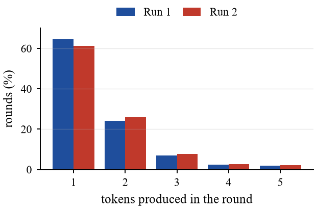

# understudy-lm

A speculative-decoding draft model for **Qwen3.5-4B**, trained only on the text
the 4B writes. Each pass it guesses the next four tokens; the 4B checks them in
one step and keeps the ones it agrees with, so the output is unchanged.

## Results

| | Run 1 | Run 2 |
|---|---|---|
| Pretraining data | 4B answers only | 75% public chat + 25% 4B answers |
| Best validation loss | 3.68 (overfit after step 4K) | **3.16** (still falling at 12K) |
| Tokens per 4B pass | 1.52 | **1.58** |
| Projected speedup | 1.38x | **1.43x** |

| Training loss | Acceptance per guess |
|---|---|
|  |  |
| **Tokens produced per round** | **Projected speedup** |
|  |  |

## How it is trained

1. **Generate:** Qwen3.5-4B (through Ollama) answers 40K prompts, giving 13.4M tokens.
2. **Corpus:** 305M tokens of public chat (SmolTalk, Tulu 3), minus those prompts.
3. **Pretrain:** a 109M-parameter decoder on 75% corpus / 25% 4B answers, 12K steps.
4. **Post-train:** add three lookahead heads, train on the 4B's answers only, 3K steps.
5. **Evaluate:** replay greedy speculative decoding over held-out 4B answers.

## Run

Needs Python 3.10+ and an NVIDIA GPU.

```bash
python run.py
```

That one command installs dependencies, pulls the 4B, generates data, trains,
evaluates and writes graphs. It resumes where it stopped, so Ctrl+C and run it
again any time. Training peaks at about 4 GB of GPU memory with the defaults;
on a smaller GPU, trade batch size for accumulation before the first run:

```bash
python run.py --set batch_size=4 --set grad_accum=16
```

```bash
python run.py --status    # progress
python run.py --summary   # results
python plots.py           # redraw graphs into out/plots
python selftest.py        # 1-minute check of the whole pipeline
```
