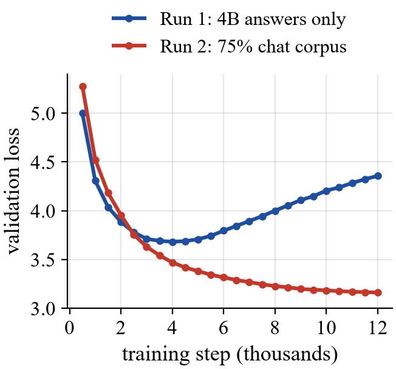
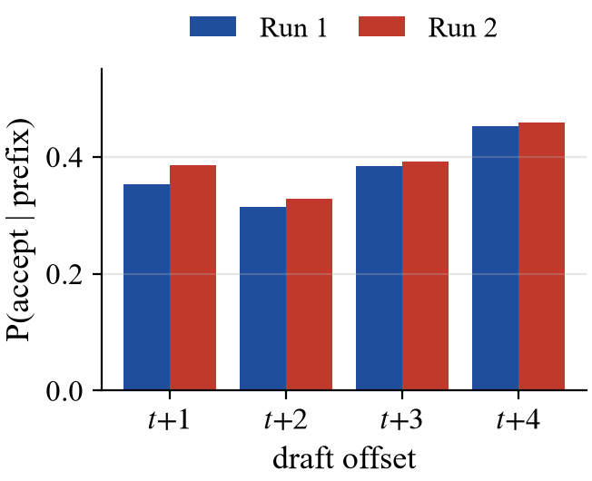
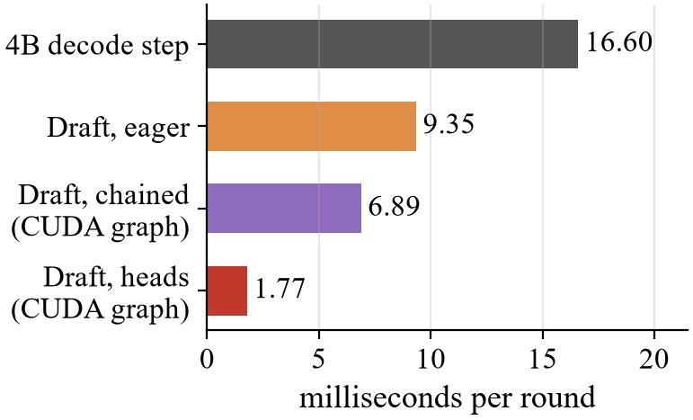
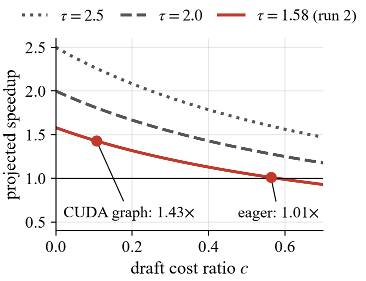

# understudy-lm

A small understudy for **Qwen3.5-4B**: a speculative-decoding draft model
trained from the 4B's text alone, on a single 6 GB laptop GPU. The 4B only
needs to be reachable through Ollama.

## Run

Needs Python 3.10+ and an NVIDIA GPU with 6 GB or more.

```bash
python run.py
```

That one command installs dependencies, pulls the 4B, generates training data,
trains the draft, evaluates it and writes graphs. It resumes where it stopped,
so Ctrl+C and run it again any time. Keep the laptop plugged in.

```bash
python run.py --status    # progress
python run.py --summary   # results
python plots.py           # redraw graphs into out/plots
python selftest.py        # 1-minute check of the whole pipeline
```

## Results

| | |
|---|---|
| Draft size | 109M parameters (95M of it the shared 248K-token embedding) |
| Tokens per 4B pass | 1.58 |
| Projected speedup | **1.43x** |
| Training time | 12.9 h pretrain + 11.4 h post-train |

| Mixing in a chat corpus stopped overfitting | Acceptance per draft position |
|---|---|
|  |  |
| **Draft round vs one 4B step** | **Projected speedup** |
|  |  |
